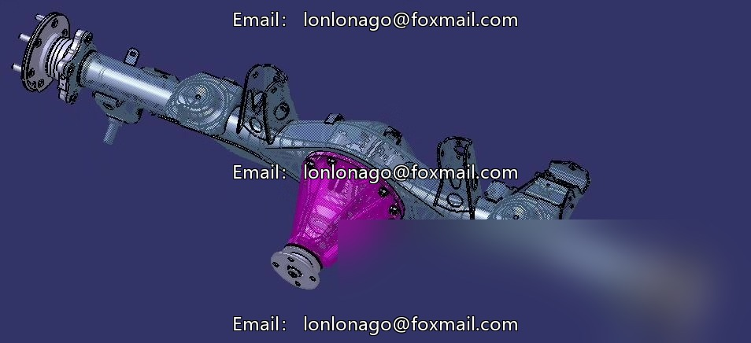
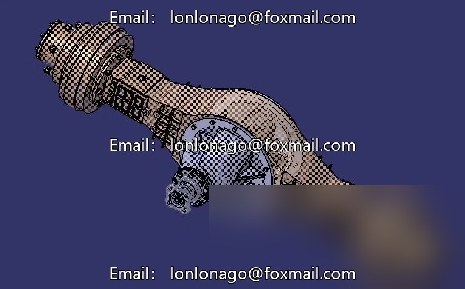
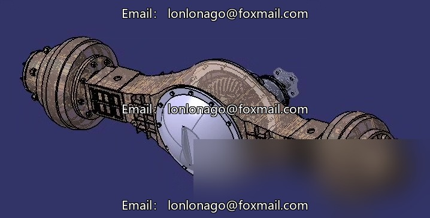

# Bridge count 3D model for the car rear bridge

## Body

Bridge number model, automobile rear bridge 3D, bridge model
Contains several data, can be opened and edited with tools such as Catia UG SolidWorks, etc.
A003 also includes other various 3D drawings, specific details to discuss further.

The car axle 3D model includes data, editable with CATIA, UG and SolidWorks; A003 contains other types of 3D drawings with details to be discussed further.

<!-- AI_ENRICHED -->

## Images

## Payment

Here is a pay link on Stripe ( https://buy.stripe.com/3cs8yP7sY87d0vu9AB ). Please contact me lonlonago@foxmail.com after funding $89, and I will send you a complete data files , thank you!

